# Gold Contract Radar — System Architecture Specification

## 1. Executive Summary
**Gold Contract Radar** is a quantitative research workstation and derivatives intelligence platform engineered for Indian gold commodity futures traded on the Multi Commodity Exchange (MCX). 

The platform normalizes disparate contract specifications (varying lot sizes, quotation conventions, and purities) into a single institutional benchmark: **₹ per gram of 999 fine gold**. It models multi-tier statutory transaction friction, tracks relative-value mispricings across active maturities, and verifies backtest executions using walk-forward out-of-sample folds.

---

## 2. End-to-End Architecture Diagram

```mermaid
flowchart TD
    subgraph ClientLayer["1. Client / Presentation Layer"]
        UI["Web Browser (Desktop / Tablet / Mobile)"]
    end

    subgraph FrontendLayer["2. Next.js 16 Frontend (React 19 + TypeScript)"]
        direction TB
        AppRouter["App Router (app/layout.tsx, app/page.tsx)"]
        Dashboard["SingleDashboard.tsx (Unified Research Workstation)"]
        
        subgraph FrontendComponents["Dashboard Component Suites"]
            HeaderComp["Header (Market Status & Live Sync)"]
            OverviewComp["Market Overview (4 Parity KPIs)"]
            InspectorComp["CustomDataInspector (MCX Quote Simulator & CSV Uploader)"]
            RadarComp["Opportunity Radar (Screened Pairs + CSV Export)"]
            DetailComp["Opportunity Evaluation Card (Z-Score & DTE)"]
            CompareComp["Contract Comparison (4 Specifications & Pair Selector)"]
            ChartsComp["Multi-View Analytics (Recharts: Spread, Trend, Curve)"]
            BacktestComp["Strategy Performance (Equity Curve, Drawdown, P&L Ledger)"]
        end

        APIClient["API Client (lib/api.ts) & Strict Typings (types/api.ts)"]
    end

    subgraph NetworkLayer["3. Transport & Protocol"]
        REST["HTTP / JSON REST API with CORS Middleware"]
    end

    subgraph BackendLayer["4. Python FastAPI Analytics Backend"]
        direction TB
        APIRouter["FastAPI Service (api/main.py)"]
        
        subgraph Endpoints["7 Authoritative REST Endpoints"]
            EP1["/api/health"]
            EP2["/api/overview"]
            EP3["/api/contracts/compare"]
            EP4["/api/futures/curve"]
            EP5["/api/opportunities"]
            EP6["/api/backtest"]
            EP7["/api/methodology"]
        end

        DataService["DataService Singleton (api/data_service.py)"]
        DataLoader["Data Loader & Memory Cache (src/dashboard/data_loader.py)"]

        subgraph QuantEngine["Quantitative Analytics Engine (src/)"]
            NormEngine["Purity & Lot Normalization (normalize_prices.py)"]
            RadarEngine["Relative Price Radar & Spreads (build_relative_price_radar.py)"]
            FilterEngine["Liquidity & Cost Screening (apply_liquidity_cost_filters.py)"]
            BacktestEngine["Walk-Forward Backtesting (run_walk_forward_backtest.py)"]
            MetricsEngine["P&L Attribution & Reconciliation (metrics.py)"]
        end

        subgraph ConfigLayer["Specifications & Cost Schedules (config/)"]
            CfgSpecs["contract_specs.json (GOLDM, GOLDTEN, GOLDGUINEA, GOLDPETAL)"]
            CfgCosts["transaction_costs.json (CTT, Stamp Duty, SEBI, Exchange, GST, Slippage)"]
            CfgLiq["liquidity_filters.json (Volume, Open Interest, Trading Thresholds)"]
            CfgBT["backtest_config.json (Walk-Forward Fold Schedule, Buffer Multipliers)"]
        end

        subgraph StorageLayer["Data Store (data/processed/)"]
            Datasets["12 Canonical Pre-calculated Datasets (~98 MB CSV)"]
        end
    end

    subgraph CloudLayer["5. Cloud Deployment Topology (Render Blueprint)"]
        WebFrontend["Web Service: goldradar-frontend (Node runtime)"]
        WebBackend["Web Service: goldradar-api (Python 3.11 + Uvicorn)"]
    end

    %% Wiring Connections
    UI --> AppRouter
    AppRouter --> Dashboard
    Dashboard --> FrontendComponents
    FrontendComponents --> APIClient
    APIClient -->|JSON Requests| REST
    REST --> APIRouter
    APIRouter --> Endpoints
    Endpoints --> DataService
    DataService --> DataLoader
    DataLoader --> ConfigLayer
    DataLoader --> StorageLayer
    DataService --> QuantEngine

    CloudLayer -.->|Provisions| FrontendLayer
    CloudLayer -.->|Provisions| BackendLayer
```



---

## 3. Layer-by-Layer Architectural Breakdown

### Layer 1: Client & Presentation
- **Access Protocol:** Cross-browser responsive web application (Desktop, Laptop, Tablet).
- **Design Tokens:** Editorial financial layout. Pure white cards (`#FFFFFF`) against a soft canvas (`#F7F8FA`) with `#E7E9ED` borders and `#B89137` gold indicators.

### Layer 2: Frontend (Next.js 16 + React 19)
- **Framework:** Next.js 16 with App Router, React 19, TypeScript.
- **Styling:** Tailwind CSS v4.
- **Visualization:** Recharts 3.x tailored for low-noise financial timeseries.
- **Key Modules:**
  - `SingleDashboard.tsx`: Central coordinator managing active state, URL filters, scenario toggles, and cross-component focus syncing.
  - `CustomDataInspector.tsx`: Interactive client-side calculator for live MCX pricing, custom pair evaluation, and drag-and-drop CSV parser.
  - `lib/api.ts`: Centralized fetch wrapper with typed responses and error handling.
  - `types/api.ts`: Strict TypeScript interfaces mirroring backend Pydantic models.

### Layer 3: REST API Protocol
- **Transport:** Asynchronous HTTP/1.1 REST using JSON payloads.
- **Middleware:** `CORSMiddleware` configured for both local development (`localhost:3000`) and production cloud origins.
- **Error Handling:** Standardized HTTP status codes (200 OK, 400 Bad Request, 404 Not Found, 500 Internal Error) with structured JSON error details.

### Layer 4: Backend Analytics Engine (FastAPI)
- **Runtime:** Python 3.11 with FastAPI and Uvicorn ASGI server.
- **Core Endpoints:**
  1. `/api/health`: Service uptime, runtime dependencies, and active universe health.
  2. `/api/overview`: Top-level parity KPIs, benchmark rate, and 250-session price history.
  3. `/api/contracts/compare`: Pairwise spread timeseries, rolling moving average, $\pm 2\sigma$ volatility bands, and histogram distributions.
  4. `/api/futures/curve`: Forward term structure across maturities, days to expiry, and roll yield history.
  5. `/api/opportunities`: Screened candidate pairs passing multi-tier filters with exact statistical Z-scores and itemized statutory friction.
  6. `/api/backtest`: Out-of-sample walk-forward backtest metrics, strategy breakdowns, and trade ledgers.
  7. `/api/methodology`: Audit metadata, mathematical formulas, and inventory of the 12 canonical datasets.

### Layer 5: Quantitative Pipeline & Data Normalization
- **Contract Normalization Formula:**
  $$\text{Normalized Fine Price (₹/g)} = \left(\frac{\text{Quoted Price}}{\text{Lot Size (grams)}}\right) \times \left(\frac{1000}{\text{Purity Fineness}}\right)$$
- **Active 4-Product Universe:**
  - `GOLDM`: 100g lot, 995 fineness (Multiplier: $1000 / 995 \approx 1.005025$)
  - `GOLDTEN`: 10g lot, 999 fineness (Multiplier: $1000 / 999 \approx 1.001001$)
  - `GOLDGUINEA`: 8g lot, 916 fineness (Multiplier: $1000 / 916 \approx 1.091703$)
  - `GOLDPETAL`: 1g lot, 999 fineness (Multiplier: $1000 / 999 \approx 1.001001$)
- **Statutory Friction Engine:** Computes CTT (0.01% sell-side), Stamp Duty (0.003% buy-side), Exchange turnover fees (0.0021%), SEBI charges (0.0001%), GST on charges (18%), and execution slippage (3 bps base case).

---

## 4. Deployment Topology

The entire monorepo is provisioned via a declarative `render.yaml` Blueprint:

```
[ GitHub Repo: Mohit-Tanwar25/goldradar-ai ]
               │
        Render Blueprint
        ┌──────┴──────────────────────┐
        ▼                             ▼
[ Web Service 1: API ]       [ Web Service 2: Frontend ]
  • Runtime: Python 3.11       • Runtime: Node 20.x
  • RootDir: backend           • RootDir: frontend
  • Command: uvicorn           • Command: npm start
  • Host: 0.0.0.0:$PORT        • Env: NEXT_PUBLIC_API_URL
```

- **Build Times:** Sub-minute build and packaging due to lean dependency profiles (zero Streamlit/Plotly overhead).
- **Cold Boot Time:** Under 2 seconds.

